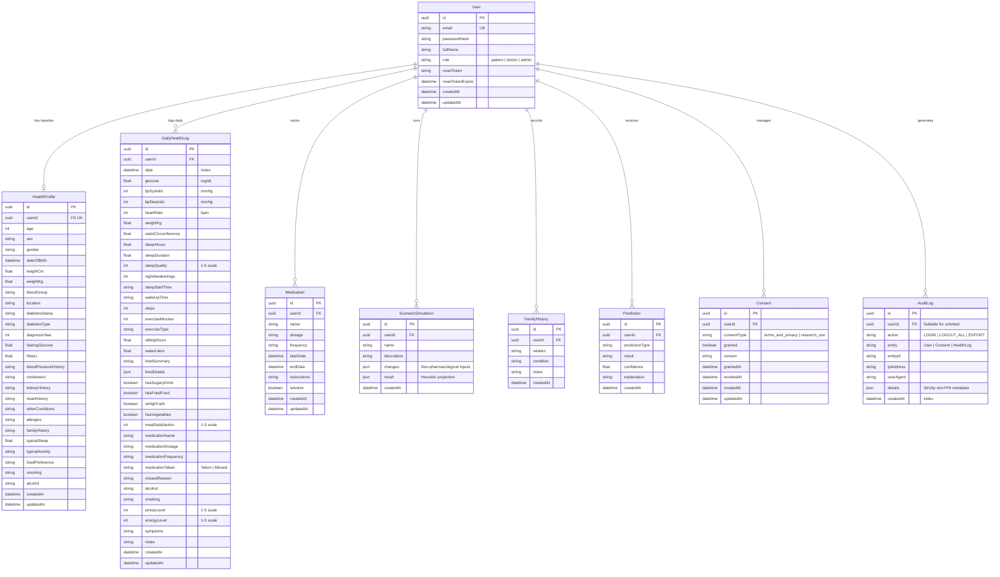

# MediTwin AI — Database Schema Specification

## 1. Entity-Relationship Diagram (ERD)

The database schema is modeled in PostgreSQL and managed through Prisma ORM v7. It establishes cascading relational integrity and strict user-level data segregation.

---

## 2. Table Specifications & Cardinality

### 2.1 `User`
- **Primary Key**: `id` (UUID v4)
- **Unique Fields**: `email` (lowercased and normalized)
- **Security Attributes**: `passwordHash` (bcrypt 12 salt rounds). Never exposed in API responses.
- **Role Field**: `role` (`patient`, `doctor`, `admin`, default: `patient`).
- **Deletion Cascade**: Owns relations with `onDelete: Cascade`. Deleting a user irrevocably purges all associated biometrics, logs, simulations, and consents.

### 2.2 `HealthProfile`
- **Cardinality**: `1:1` with `User` (`userId` marked `@unique`).
- **Purpose**: Stores baseline demographic and clinical context (Type 2 diabetes diagnosis year, baseline HbA1c, typical sleep, baseline activity).

### 2.3 `DailyHealthLog`
- **Cardinality**: `1:N` with `User`.
- **Indices**:
  - `@@index([userId])` for rapid per-patient metric lookups.
  - `@@index([date])` for chronological window queries across 7, 14, and 30-day intervals.
- **Data Protection**: Clinical biometrics are isolated to this table and never copied into security audit trails.

### 2.4 `Medication`
- **Cardinality**: `1:N` with `User`.
- **Purpose**: Tracks active medication schedules and dosages.
- **Safety Boundary**: Read-only in simulations; medication parameters cannot be altered by simulator projections.

### 2.5 `ScenarioSimulation`
- **Cardinality**: `1:N` with `User`.
- **Purpose**: Persists lifestyle what-if evaluations (+2,000 steps daily, +1h sleep, 7 alcohol-free days).
- **Structure**: Stores `changes` and `result` payloads containing current pattern vs. simulated pattern and transparent confidence ratings (`Confidence: low`).

### 2.6 `Consent`
- **Cardinality**: `1:N` with `User`.
- **Types**:
  - `terms_and_privacy`: Mandatory terms acceptance at account registration.
  - `research_use`: Optional de-identified aggregate research participation (revocable anytime).

### 2.7 `AuditLog`
- **Indices**: `@@index([userId])`, `@@index([createdAt])`.
- **Privacy Rule**: Strictly sanitizes the `details` JSON field to prevent storing glucose, blood pressure, medications, dosages, or food entries.
