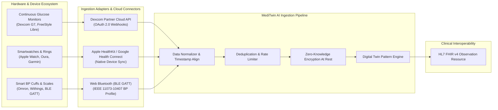

# MediTwin AI — Future Hardware-Integration Strategic Roadmap

## 1. Executive Summary

While the current MediTwin MVP relies on high-fidelity, validated manual data entry, the next evolution involves continuous, automated physiological data ingestion. This document details the strategic architecture for integrating Continuous Glucose Monitors (CGMs), smart wearables, and Bluetooth Low Energy (BLE) medical vitals peripherals.

---

## 2. Target Device Classes & Integration Specifications

### 2.1 Continuous Glucose Monitors (CGMs)
Continuous glucose streams provide the richest temporal data for evaluating glycemic variability and postprandial responses.

| Device Ecosystem | Integration Mechanism | Protocol / Auth | Sampling Frequency | Ingested Metrics |
| :--- | :--- | :--- | :--- | :--- |
| **Dexcom G6 / G7** | Dexcom Partner API | OAuth 2.0 + REST Webhooks | Every 5 minutes (288 readings/day) | `egv` (Estimated Glucose Value), Trend Arrow, Trend Rate |
| **Abbott FreeStyle Libre 2 / 3** | LibreLinkUp Cloud Gateway | REST JSON API + Mutual TLS | Every 1-5 minutes | Interstitial Glucose (mg/dL), Raw Scan Values |

- **Data Processing Strategy**:
  - Raw 5-minute telemetry is buffered into a high-throughput time-series store.
  - An hourly rollup calculates Mean Glucose, Standard Deviation (SD), and Coefficient of Variation (%CV).
  - Time in Range (TIR: 70–180 mg/dL) is computed over 24-hour windows and supplied to the Digital Twin `glucoseTrend` state.

### 2.2 Smartwatches & Wrist Wearables
Automates sleep staging, continuous heart rate, and step velocity tracking without requiring manual journal logging.

| Platform | Integration Channel | Authorization Model | Primary Metrics Ingested |
| :--- | :--- | :--- | :--- |
| **Apple HealthKit** | iOS Native Companion App | CoreOS Permission Dialog | `HKQuantityTypeIdentifierStepCount`, Sleep Stages (Deep, Core, REM), Resting Heart Rate, Active Energy |
| **Google Health Connect** | Android Jetpack Health Client | Android 14 Granular Permissions | `StepsRecord`, `SleepSessionRecord`, `HeartRateRecord`, `ExerciseSessionRecord` |
| **Garmin Connect** | Garmin Health API | OAuth 2.0 Push Architecture | Daily Movement, Body Battery, Overnight HRV Status |
| **Oura Ring** | Oura Cloud API v2 | Personal Access Token / OAuth 2.0 | Sleep Score, Readiness Index, Skin Temperature Deviation |

### 2.3 Connected Blood Pressure Cuffs & Smart Scales
Enables zero-friction hemodynamic monitoring for pre-hypertensive and hypertensive users.

| Peripheral Class | Target Devices | Protocol Standard | Ingestion Workflow |
| :--- | :--- | :--- | :--- |
| **Smart BP Cuffs** | Omron Evolv, Withings BPM Core | BLE GATT Profile `0x1810` (Blood Pressure Service) | Direct Web Bluetooth pairing via browser or Omron Cloud webhook. Captures systolic, diastolic, and pulse rate upon cuff deflation. |
| **Smart Body Composition** | Withings Body Smart, Eufy P2 Pro | BLE GATT Profile `0x181D` (Weight Scale Service) | Transmits weight (kg), body fat percentage, and bioimpedance measurements. |

---

## 3. Ingestion Pipeline & Privacy Architecture

### 3.1 Edge Filtering & Normalization
1. **Timestamp Reconciliation**: All device streams are converted from local device clock to UTC ISO-8601 strings.
2. **Frequency Throttling**: Wearable step events (which can fire every second) are aggregated into 15-minute intervals to avoid database bloat.
3. **Outlier Sanitization**: Biometric bounds checking rejects physiological anomalies (e.g. glucose < 20 or > 600 mg/dL, systolic BP > 300 mmHg) caused by sensor compression or dislodgement.

### 3.2 Clinical Interoperability (HL7 FHIR v4)
All normalized device readings map directly to HL7 FHIR v4 standard resources for potential Electronic Health Record (EHR) export:
- Blood Glucose: `LOINC 2339-0` (Glucose [Mass/volume] in Blood)
- Blood Pressure: `LOINC 85354-9` (Blood pressure panel with all children)
- Heart Rate: `LOINC 8867-4` (Heart rate)
- Body Weight: `LOINC 29463-7` (Body weight)
- Daily Steps: `LOINC 41950-7` (Number of steps in 24 hour Measured)

### 3.3 Security & Patient Consent Controls
- **Granular Device Permissions**: Users can connect a smartwatch for steps and sleep while keeping blood pressure or glucose manual.
- **Instant Revocation**: Disconnecting a device token in the Privacy center triggers an immediate token wipe and halts cloud webhooks.
- **Zero Raw PHI in Audit Trails**: Ingestion telemetry only records event counts (e.g., `DEVICE_SYNC: 288 readings ingested`) without logging physiological values.
