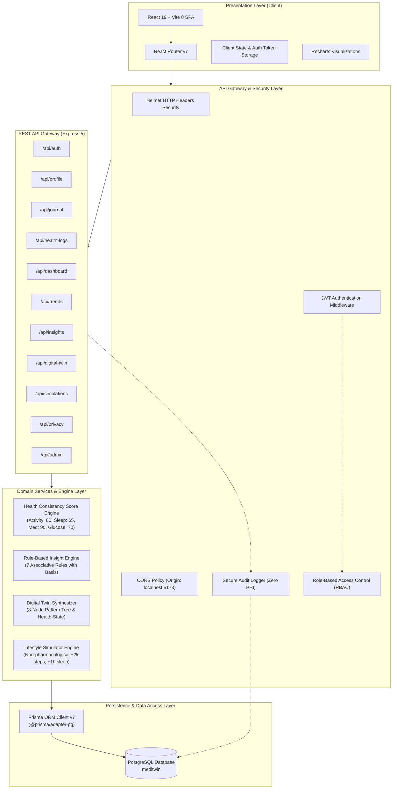

# MediTwin AI — System Architecture & Design Specification

## 1. Architectural Overview

MediTwin AI is architected as a decoupled, multi-tier health intelligence application designed for high security, data privacy, and modular extensibility. It models personal health trends through a non-clinical digital twin representation, calculates wellness consistency scores, generates associative rule-based insights, and simulates non-pharmacological habit changes.

---

## 2. Layered Component Responsibilities

### 2.1 Presentation Layer (Frontend)
- **Framework**: React 19 running on Vite 8 build tooling.
- **Styling**: Tailwind CSS v4 featuring responsive flex/grid layouts, mobile-friendly cards, and accessibility-compliant contrast.
- **Data Visualization**: Recharts rendering multi-metric time series for blood glucose, systolic/diastolic blood pressure, daily steps, and sleep duration.
- **Protected Routing**: `ProtectedRoute.jsx` intercepts unauthorized navigation and enforces Role-Based Access Control (`patient`, `doctor`, `admin`).
- **Privacy Controls**: Direct client-side JSON Blob data export and interactive research-use consent management.

### 2.2 Security & Middleware Layer
- **HTTP Hardening**: Helmet sets security headers including Content-Security-Policy, X-Frame-Options, and Strict-Transport-Security.
- **Authentication**: Stateless HMAC-SHA256 JSON Web Tokens (JWT) with 7-day expiration and tamper protection.
- **Session Revocation**: Real-time revocation checking against the `AuditLog` table on `LOGOUT_ALL_SESSIONS` events, invalidating all issued tokens across devices upon request.
- **Role-Based Authorization (RBAC)**: `requireRole(...allowedRoles)` middleware isolates patient records, doctor clinical consoles, and administrator telemetry.
- **Secure Audit Logging**: `logAudit` records system security events (logins, exports, consent changes) with strict programmatic filtering that prevents any Protected Health Information (PHI) or biometrics from entering logs.

### 2.3 Domain Engines Layer
1. **Health Consistency Score Engine**:
   - Calculates a transparent prototype wellness consistency score out of 100 based on activity consistency, sleep consistency, medication adherence, glucose consistency, and dietary flags.
   - Explicitly labeled: *"Prototype wellness consistency score—not a clinical score."*
2. **Rule-Based Insight Engine**:
   - Evaluates 7 core heuristic rules over a 14-day observation window:
     - Low average sleep (<6 hours)
     - Low step count (<5,000 steps)
     - Missed medication entries
     - Higher glucose after late meals
     - Higher glucose on low-activity days
     - Improved readings after exercise
     - Incomplete data patterns
   - Formulates all insights using strictly associative language (*"associated with"*) rather than claiming medical causality, and supplies clinical basis statements.
3. **Digital Twin Synthesizer**:
   - Constructs an 8-node hierarchical pattern tree representing the user's changing lifestyle trends without exaggerated future predictions.
   - Outputs a normalized `healthState` JSON object.
4. **Lifestyle Simulator Engine**:
   - Models hypothetical adjustments (+2,000 steps daily, +1 additional sleep hour, 7 alcohol-free days).
   - Enforces side-by-side comparison (`Current pattern versus Simulated pattern`) with transparent low confidence ratings.
   - **Safety Boundary**: Hardcoded prohibition rejecting insulin and medication dosage modifications with HTTP 400.

### 2.4 Persistence Layer
- **Database**: PostgreSQL 16.
- **Object-Relational Mapping**: Prisma ORM v7 with `@prisma/adapter-pg`.
- **Referential Integrity**: Cascading deletes (`onDelete: Cascade`) ensure that when an account is deleted, all daily logs, medications, simulations, and consents are permanently purged.
